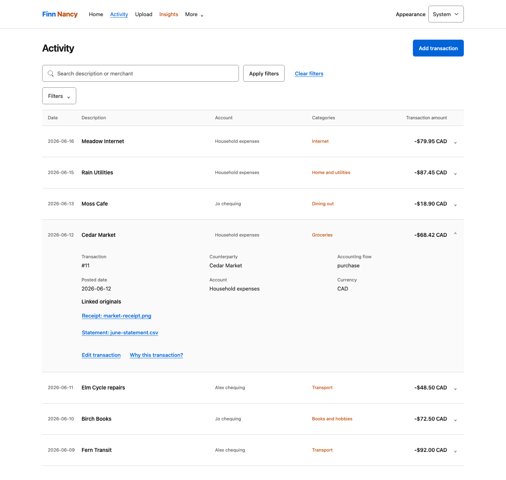

# Finn Nancy

A local-first household finance workspace. **Finn** handles bookkeeping and recorded facts; **Nancy** handles categories, planning, and financial questions.

Save a receipt, bring in account statements, and reconcile the evidence without recording the same expense twice. Follow income, money out, cash movement, and balances back to their contributing rows. Close a period when the evidence is explainable—not just when the dashboard looks tidy.



*Fictional household, real application screens: Alex and Jo's activity stays alongside shared expenses. The Cedar Market purchase links both originals after a confirmed match, without booking another expense.*

## Start here

- **[Self-host getting started](docs/GETTING_STARTED.md)** — install from source and start an empty ledger on loopback.
- **[Common-flow walkthroughs](docs/DEMO_WALKTHROUGHS.md)** — receipt capture, reconciliation, household setup, reports, and planning.
- **[Disposable local sandbox](docs/SANDBOX.md)** — try the fictional household without touching a real ledger; see the [screenshot catalog](docs/MEDIA.md).
- **[Optional Plaid setup](docs/PLAID_SETUP.md)** — Trial eligibility, Production access, and the application's actual Hosted Link configuration.

You can use Finn Nancy without Plaid or an assistant. Automatic document extraction needs a configured model; manual bookkeeping and structured statement import do not require a bank connection.

## Everyday work

| Task | Where it happens |
| --- | --- |
| Preserve a receipt or statement | Upload → Processing; keep the original until **Saved** |
| Inspect recorded transactions | Activity, with filters and linked evidence |
| Resolve statement rows | Review → reconciliation; match an existing expense or explicitly record a new one |
| Add household members and optional banks | Connections; ownership and household inclusion are separate choices |
| Explain a month | Period statements and close checks |
| Plan from recorded activity | Insights, categories and budgets, Goals |

<details>
<summary>What happens when a receipt meets its statement?</summary>

1. Upload the receipt and review any extraction issues.
2. Import the account statement and check its staged rows.
3. Confirm the match in reconciliation instead of creating a second expense.
4. Inspect the recorded transaction and its supporting evidence.

A bank-feed observation is not automatically a booked transaction or a complete statement. Suggested categories still need approval. [Open the walkthroughs](docs/DEMO_WALKTHROUGHS.md).

</details>

## Hosting and privacy

Your ledger and original documents live on the server you control. **The web UI has no app-level authentication.** Bind it to loopback; access from another device requires an authenticated, access-controlled private overlay with no public sharing. Do not expose it directly to a LAN or the Internet.

Plaid, Telegram, merchant search, and remote model endpoints are optional external services. A configured model receives prompts and document-derived content; use a local endpoint for local inference. `STRICT_LOCAL_MODE=true` blocks the optional bank/search/Telegram paths, but does not make a remote model endpoint local. See the [configuration guide](docs/GETTING_STARTED.md#configuration) before enabling integrations.

This is an experimental application. Review imported data, accounting decisions, categories, and assistant output. It has not been independently security audited.

<details>
<summary>For contributors</summary>

Start with [AGENTS.md](AGENTS.md) and the [context map](docs/context-map.md). Use the canonical wrappers:

```sh
uv sync --frozen --group dev --group mcp
scripts/lint
scripts/test
scripts/build
scripts/smoke
```

Use generated data only. See [delivery policy](docs/DELIVERY.md), [security](SECURITY.md), and [public-source release guidance](docs/PUBLIC_RELEASE.md).

</details>

## License

Apache-2.0. See [LICENSE](LICENSE), [NOTICE](NOTICE), and [third-party notices](THIRD_PARTY_NOTICES.md).
