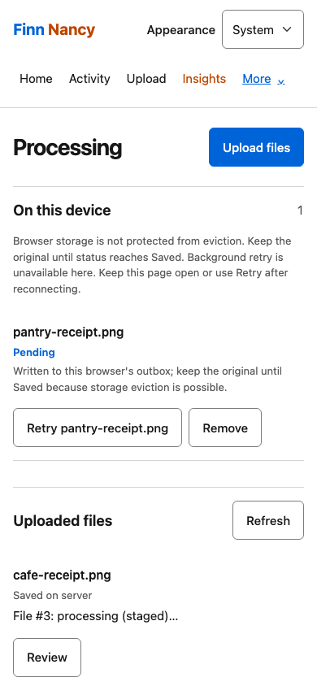
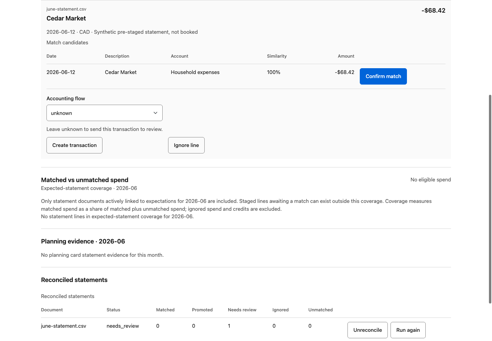
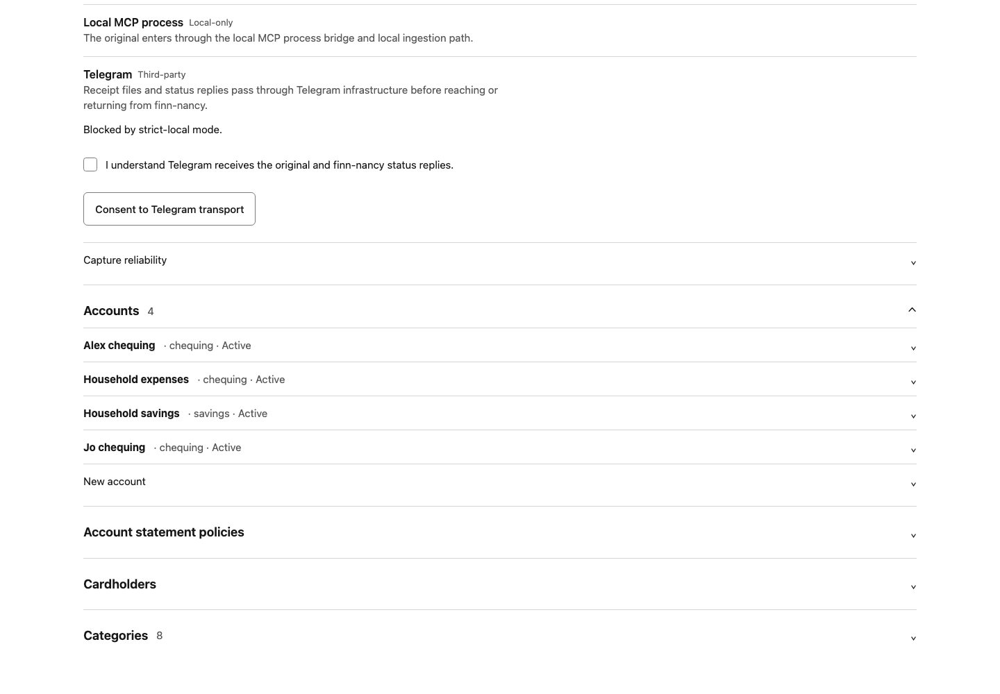
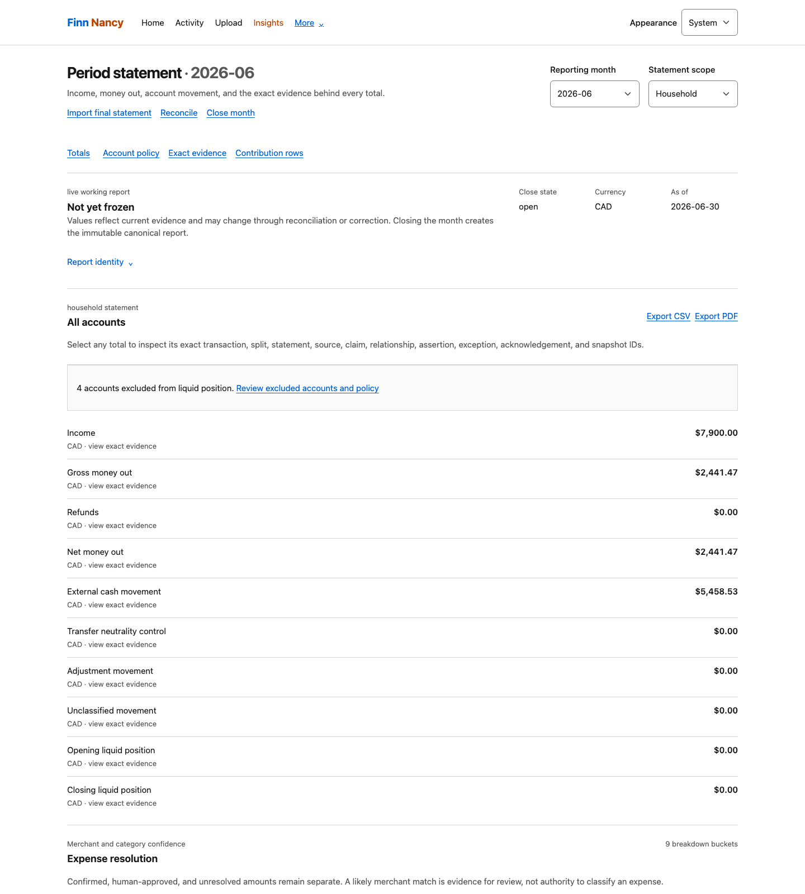
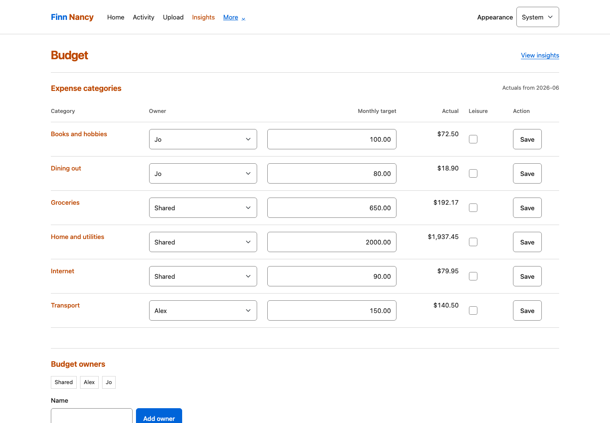

# Common-flow walkthroughs

Choose the task you want to try. Use a separate synthetic workspace for demonstrations; keep real financial data and credentials out of recordings.

The screenshots show real application states with fictional people, accounts, merchants, and documents from the June 2026 household sandbox. See the [media catalog](MEDIA.md) for the scenario and reproduction commands.

| Flow | Outcome |
| --- | --- |
| Receipt → Processing | Know which originals are still device-owned and which are Saved |
| Statement → reconciliation | Link evidence to one expense instead of booking it twice |
| Household → optional bank | Separate member identity, bank access, ownership, and inclusion |
| Activity → period statement | Trace reported money back to contributing rows |
| Categories → planning | Review classifications before using them for budgets and goals |

For a new real workspace, follow [getting started](GETTING_STARTED.md); do not load sample data into a household ledger.

Save a receipt and recover a pending upload

*Pending remains in this browser's outbox; Saved acknowledges the server copy, not completed extraction. Background retry is unavailable in this capture browser. Workers are off: staged jobs have made no extraction attempts.*

1. Open Upload on the device holding the original. Select the receipt.
2. Follow the notification to Processing. **Pending** means the device still owns the unacknowledged file; keep the original and browser storage.
3. If connectivity is interrupted, return to Processing after reconnecting and use the available recovery/retry action. Do not keep selecting the same file as a substitute for checking its status.
4. Wait for **Saved**: the server has acknowledged its durable copy. Extraction and accounting review are later, separate phases.
5. Open Review if processing needs a decision. Inspect the original before approving extracted information.

**Check:** one preserved original with a clear processing state, not a success toast standing in for storage. Automatic image/PDF extraction requires a working configured model.

Import a statement and match an existing receipt

*The statement line is pre-staged, not newly parsed or booked. Confirm match attaches it to the existing CAD 68.42 expense; the resulting Activity view retains both originals without adding a transaction.*

1. Add the account and its statement expectation in Manage. Choose the correct account and period for the source.
2. Upload a statement PDF for extraction, or use structured CSV/OFX import and inspect the preview before confirming. Review the source, rows, currency, dates, and balances.
3. Resolve statement-review issues, then open reconciliation. Statement rows are staged evidence, not a second set of booked expenses.
4. Inspect the proposed receipt match and confirm only when the evidence agrees. For genuinely new activity, explicitly review and record it through the available reconciliation action.
5. Leave ambiguous matches or flow meaning in review. A positive amount is not automatically income; a transfer, refund, or reimbursement needs its actual meaning.
6. Return to Activity and inspect the linked evidence.

**Check:** the receipt and matching statement line support one expense. See [initial reconciliation](INITIAL_RECONCILIATION.md) and [statement expectations](STATEMENT_EXPECTATIONS.md).

Add a household and optionally connect a bank

*Four local accounts keep personal and shared activity legible. Their names describe the household story, not member access permissions or verified bank ownership. Telegram remains blocked by strict-local mode.*

1. Open Connections. Add yourself using a name the household recognizes; add other members as needed.
2. For local-only use, stop here and maintain accounts in Manage. A household member does not require Plaid.
3. For bank access, first complete [Plaid setup](PLAID_SETUP.md), then select the member, grant current consent, and choose Add bank.
4. Complete external Hosted Link and return to the same browser session for server verification.
5. Map accounts deliberately: ownership, household inclusion, and ledger account. For a joint account returned by two connections, map to the same ledger account with primary/secondary roles.
6. Sync and review Bank feed before booking or matching observations.

**Check:** Connected by identifies access, not automatic ownership. A feed sync does not establish complete statement coverage.

Explain a month and close it

*Start with the purchase and its two originals, then follow the period totals back to their contributing rows.*

*The open report shows CAD 7,900.00 income, CAD 2,441.47 net money out, and CAD 5,458.53 external cash movement. All four accounts lack stated as-of balances and are excluded from verified liquid position: the zero included subtotal is not a zero household balance. Close remains blocked.*

1. In Activity, choose the relevant period and filters. Open evidence for a transaction you want to understand.
2. Open the period statement. Follow income, money-out, cash-movement, and account rows back to their contributing transactions rather than treating every negative amount as spending.
3. Open Close and inspect expected statements, reconciliation, balances, and unresolved reviews.
4. Resolve the underlying issue when a check blocks close. Do not waive evidence just to turn a status green; use an available exception only with a deliberate reason.
5. Complete the applicable close workflow when the checks and evidence justify it. Reopening is an explicit action before later accounting changes.

**Check:** a supported period statement and explainable close, with incomplete or unknown state still visible. See the [accounting contract](ACCOUNTING_CONTRACT.md).

Review categories, then plan

*Shared groceries, home and utilities, and internet sit beside Alex's transport and Jo's books and dining budgets. Budget owners organize plans; they do not grant account access or establish transaction ownership.*

1. Inspect uncategorized or suggested classifications alongside their transaction evidence. A provider or assistant suggestion is not an approved category.
2. Review pending actions in Approvals and accept or reject deliberately. Recheck the recorded result.
3. Open Categories to review category budgets, and Insights for the available spending and planning views.
4. Use Goals for an explicit target and review its progress in context. A plan is not a transaction or a booked transfer.
5. If configured, ask a financial question through Chat. Check the supporting records before acting on an answer.

**Check:** planning uses reviewed records. Optional assistant availability depends on your configured model/chat integration; the walkthrough does not require an external assistant.

